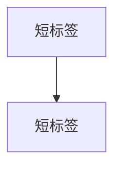

# DDIA 权衡卡 · 内容源

本目录是「DDIA 权衡卡」PWA 的卡片源文件。每张卡是一个 Markdown 文件，
由 `../build.py` 渲染为单文件 HTML（`../index.html`），
部署在 https://c2j.github.io/ddia/cards/

## 当前规模

共 **51 张卡**，覆盖第 1–13 章（沿用 DDIA 第 2 版章节编号）：

| 章 | 主题 | 张数 |
|----|------|------|
| 第1章 | 数据系统架构中的权衡 | 1 |
| 第2章 | 定义非功能性需求 | 2 |
| 第3章 | 数据模型与查询语言 | 3 |
| 第4章 | 存储与检索 | 5 |
| 第5章 | 编码与演化 | 2 |
| 第6章 | 复制 | 10 |
| 第7章 | 分片 | 4 |
| 第8章 | 事务 | 6 |
| 第9章 | 分布式系统的麻烦 | 4 |
| 第10章 | 一致性与共识 | 3 |
| 第11章 | 批处理 | 4 |
| 第12章 | 流处理 | 4 |
| 第13章 | 流式系统的哲学 | 3 |

## 三种卡片类型

- `P-` 困境卡：给场景与约束、不给选项；自己先想方案，再看揭示中的代价
- `S-` 推演卡：给运行/故障序列，逐步推演系统行为，先预测再看答案
- `I-` 事故档案卡：真实事故叙事，作为记忆钩子

## 文件格式

```markdown
id: P-4.1-01              # 类型-章.节-序号，全局唯一（用作 localStorage 键）
type: dilemma             # dilemma | simulation | incident
chapter: §4.1 存储与检索   # 决定目录分组（须与正文章节号一致）
title: 卡片标题

## 场景
...（困境卡/事故卡用「场景」，推演卡用「推演序列」）

## 你的问题
...

## 揭示
...（其中应包含一条"你可能没想到的"洞察）

## 图


## 自测
- 判断: 题干 [对] 或 [错]
- 单选: 题干 | 选项A | 正确选项* | 选项C

## 原文关联
- [§4.1 小节标题](/ch4/#anchor)
```

### 规则与约定

- **ID 全局唯一**：重复会让 localStorage 的已读/收藏/答错状态串卡
- **chapter 字段**决定目录分组；目录标签（「第N章 章名」与条目上的小节名）
  自动从 `content/zh/chN.md` 读取，**不要手写章名映射**
- **原文关联**：链接格式为 `/chN/#anchor`，锚点必须是 `content/zh/chN.md`
  中真实存在的 `{#anchor}`（build.py 会自动补上部署前缀 `/ddia`）
- **mermaid**：节点标签统一加引号；`subgraph` 必须写成 `subgraph ID["标题"]`
- **自测**：每张卡至少 2 题；判断题答案只允许「对」或「错」；
  单选题用 `*` 标记且只能有一个
- 正文以「具体场景」开头，避免直接给结论；揭示里给反直觉洞察
- 中文使用全角标点；不用 em dash

## 新增卡片流程

```bash
cd cards
vim src/P-14.1-01-xxx.md     # 新建卡片
SITE_BASE=/ddia python3 build.py   # 本地构建，输出 index.html
git add -A && git commit -m "cards: ..." && git push
```

推送后 `.github/workflows/deploy-cards.yml` 自动重新构建并部署到 GitHub Pages。

## 校验

```bash
python3 check.py    # 校验卡片完整性、ID 唯一、自测格式、锚点有效性
```

校验项见脚本头部注释（frontmatter 字段、段落完整性、ID 唯一、
自测格式、mermaid 配对、原文关联锚点是否存在、文件名与 id 一致性）。
退出码非 0 表示存在问题，会逐条列出。建议提交前必跑，

`.github/workflows/deploy-cards.yml` 部署前也会执行一遍（见工作流定义）。

## 说明

个人学习用途。《Designing Data-Intensive Applications》版权归原作者与出版社所有，
本目录仅存放自制的学习卡片摘要，原书完整译文位于仓库 `content/zh/`。
